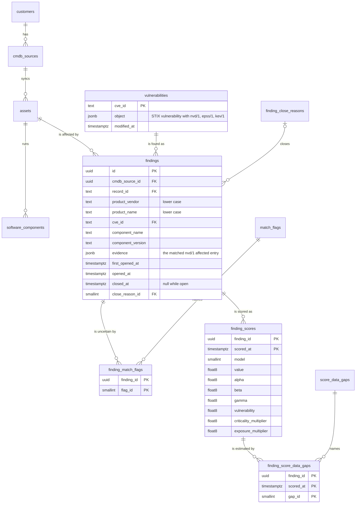

# A Finding is one row per Asset, Product and Vulnerability, opened and closed but never deleted

The asset filter decides whether a Vulnerability affects a Software Component (ADR 0015) and the Scoring Model scores the result (ADR 0009). This ADR decides how a match is stored as a Finding, how a Finding changes over time, and which events change it.

## A Finding over time

On 1 March NVD publishes CVE-2021-23017, which affects `f5:nginx` from 0.6.18 up to but not including 1.20.1. The payments server runs nginx 1.18.0:

| Date | Event | The Finding (payments server, `f5:nginx`, CVE-2021-23017) |
|---|---|---|
| 1 March | The CVE arrives and matches | opened, version 1.18.0, scored |
| 2 March | EPSS rises | rescored; a new Score is stored |
| 5 March | nginx is upgraded to 1.19.0, still vulnerable | same Finding, version 1.19.0 |
| 9 March | nginx is upgraded to 1.20.1 | closed, `no_longer_affected` |
| 20 March | nginx is rolled back to 1.18.0 | the same Finding is reopened, with its Score history |

## Tables

- **`vulnerabilities`** keeps only the Vulnerabilities that opened at least one Finding (ADR 0015), one row per CVE shared by every Customer, as the STIX object with its extensions. A Finding is rescored when EPSS or KEV changes, and that needs the CVSS of its Vulnerability, so the Vulnerability is kept with it. Each Feed updates only its own extension key (ADR 0010); a KEV or EPSS object for a CVE that is not stored is ignored.
- **`findings`** is unique on `(cmdb_source_id, record_id, product_vendor, product_name, cve_id)`: the Asset, the Product and the Vulnerability. The Product is stored in lower case, since Products match ignoring case (ADR 0015). The Customer is the Asset's, through its CMDB Source. `id` is a UUID that never changes, so the Agents' `finding_id` (ADR 0016) can reference it.
- **`component_name` and `component_version`** are copied from the matched Software Component and updated whenever it is matched again. Software Components are rewritten on every Sync and have no identity, so a Finding cannot point at one. `evidence` is the matched `affected` entry, CPE `criteria` included, so a person can see why it matched.
- **Open or closed** is `closed_at`: null while open. There is no separate boolean that could disagree with it. `first_opened_at` never changes; `opened_at` is when the current open period began.
- **Match Flags** (ADR 0015) are one row each in `finding_match_flags`; none means a certain match. Uncertain ("dudoso") is derived as having at least one, never stored. They are replaced every time the Finding is matched again.
- **`finding_scores`** is the Score history of ADR 0009: the Scoring Model, the value and every factor, with its Data Gaps in `finding_score_data_gaps`. A new Score is stored only when its model, value or Data Gaps differ from the latest one, so a daily EPSS feed that changes nothing adds no row.

`match_flags`, `finding_close_reasons` and `score_data_gaps` are catalog tables keyed by Go constants (ADR 0006): the Match Flags of `matching`, the Data Gaps of `scoring`, and these close reasons of `finding`:

| id | name | When |
|---|---|---|
| 1 | `no_longer_affected` | the component's version no longer matches, because it changed or because NVD changed the Vulnerability's entries |
| 2 | `component_removed` | the Asset no longer has a Software Component with that Product |
| 3 | `asset_inactive` | the Asset became Inactive (ADR 0005) |
| 4 | `vulnerability_rejected` | NVD rejected the CVE |

A closed Finding that matches again is reopened: `closed_at` and its reason are cleared and `opened_at` is set. Closed Findings are not rescored (ADR 0009).

## How it is stored

The pure domain package `internal/finding` holds what `postgres` stores: a Finding's `ID`, its `Key` (built by `NewKey`, which lower-cases the Product and checks the CVE ID), the `Match` that `NewMatch` makes of a `matching.Result`, the `Outcome` of saving it and the `CloseReason`s. `postgres` writes it through these methods of `Tx`, one query each unless said otherwise (`internal/postgres/queries/vulnerabilities.sql` and `findings.sql`):

| Method | What it does |
|---|---|
| `StoreVulnerability` | inserts a Vulnerability, or replaces its NVD data while keeping the extensions other Feeds set; an older `modified_at` never replaces a newer one |
| `SetVulnerabilityExtension` | sets one extension (`kev/1`, `epss/1`) of a stored Vulnerability, and reports false when the CVE is not stored |
| `Vulnerability`, `VulnerabilitiesAffecting` | read a stored Vulnerability, or those whose `nvd/1` entries name one of some Products, ignoring case |
| `ComponentsWithProducts`, `ComponentsOfAssets` | read the Software Components of Active Assets that can be matched, with the Criticality and Exposure that scoring needs |
| `SaveMatch` | opens, updates or reopens the Finding of a `Match` in one statement and replaces its Match Flags, in one transaction; it returns the Finding's `ID` and the `Outcome` |
| `CloseFinding`, `CloseFindingsOfInactiveAssets` | close one open Finding, or the open Findings of a CMDB Source's Inactive Assets |
| `OpenFindingsOfVulnerability`, `OpenFindingsOfSource` | read the open Findings to rescore or to match again |
| `MatchFlags` | read the Match Flags of a Finding |
| `SaveScoreIfChanged`, `LatestScore` | store a Score unless the latest has the same Scoring Model, value and Data Gaps; read the latest |

- **One statement opens, updates or reopens.** `SaveMatch` is an `INSERT ... ON CONFLICT DO UPDATE` on the Finding's key, so two matches of the same Finding at once cannot both insert it. What the Finding was before (absent, open or closed) is read in the same statement, so the `Outcome` needs no second query.
- **Times come from Postgres.** `first_opened_at`, `opened_at` and `closed_at` are the transaction's time, so `first_opened_at <= opened_at <= closed_at` holds whatever the application's clock says. A Score's `scored_at` is the statement's own time, so two Scores of one Finding in one transaction never share it.
- **Products are compared in lower case in SQL as well**, on both the Finding and the Software Component, since components keep the Product as the CMDB wrote it (ADR 0019).

## One Finding for a Product installed twice

An Asset can have two Software Components with the same Product, such as two installations of Vault at 1.16.1 and 1.17.0. They share the Finding's key, so they are one Finding. It stays open while any of them matches, and shows the component whose match is most certain, as `Match` already prefers an entry without flags (ADR 0015); between equally certain components, the first in the Asset's order.

## What changes a Finding

A use-case package, `internal/findings` (ADR 0008), calls `matching`, `scoring` and `postgres`:

| Event | What happens |
|---|---|
| NVD publishes or modifies a CVE | It is matched against the Software Components of every Active Asset with one of its Products. A match stores the Vulnerability and opens, reopens or updates the Finding, and scores it. Its open Findings that no longer match are closed, and all of them when it is `Rejected`. |
| KEV or EPSS has an object for a stored CVE | Its extension is updated and the open Findings of that CVE are rescored. |
| A Sync of a CMDB Source finishes | Every Active Asset it touched is matched again against the stored Vulnerabilities: Findings that no longer match are closed, those that match are updated and rescored (its Criticality may have changed), and new matches are opened, so an Asset synced for the first time is matched against every Vulnerability already stored. The Findings of Assets that became Inactive are closed. |

Matching a new Asset against stored Vulnerabilities does not bring back old CVEs (ADR 0015): barbattack never fetches a CVE it was not sent, it only reuses those that already opened a Finding for some Asset.

### How the use case runs

`findings.Service` has one function per event: `HandleNVD`, `HandleKEV` and `HandleEPSS` have the shape of `ingest.Feed.Handle` and receive each pull in batches of up to 1,000 objects, and `AfterSync` takes the CMDB Source a Sync committed. `serve` wires them: it hands the `nvd`, `kev` and `epss` Feeds to the Findings, and has the `cmdb` use case call `AfterSync` through `cmdb.Service.OnSynced`, so `cmdb` never imports `findings`. `feed pull` hands them to nothing and needs no database.

- **One Vulnerability, one transaction.** A failure is logged and the rest of the batch still runs, since a `Handle` that returns an error stops its Feed's whole pull. Only a cancelled context stops a batch.
- **No Feed data is kept in memory.** A KEV or EPSS entry for a CVE that is not stored is ignored, so a Vulnerability first matched between two pulls is scored without its KEV listing and EPSS until the next pull sets them and rescores it: at most an hour for KEV and a day for EPSS. Until then its Score carries `epss_pending`, and its KEV factor is 0. A cache of the last catalog was considered and left out to keep nothing that no Finding needs.
- **EPSS asks once per batch.** It has an entry for every CVE, so each batch first asks which of its CVEs are stored (`StoredCVEs`) and touches only those.
- **A stale KEV catalog.** The Service remembers only when KEV last arrived. A Score is `kev_stale` when no KEV catalog arrived since the server started, or the last one is older than two KEV pull intervals.
- **The whole CMDB Source after a Sync.** `AfterSync` matches every Active Asset of the source, not only the ones that changed; a Sync already reads the whole CMDB. A Vulnerability that fails leaves its Findings as they were, rather than closing them as no longer matched. A failing `AfterSync` is logged, and the Sync stays succeeded.
- **What a Score reads.** `finding.ScoreInputs` reads a stored Vulnerability's CVSS (the newest version of NVD's Primary metrics, else of the numbering authority's Secondary ones), EPSS and KEV listing, as ADR 0009 says.

## Considered Options

- **No `vulnerabilities` table, the CVSS copied into each Finding**: rejected; every Feed would have to update every Finding of a CVE, and a Sync could not match a new Asset against what was already received.
- **An `open` boolean next to `closed_at`**: rejected; two fields saying the same thing can disagree.
- **A Finding referencing its Software Component**: rejected; components are rewritten on every Sync.
- **One Finding per installation**: rejected; the key agreed for Findings is the Asset, the Product and the Vulnerability, and one problem on one Asset is one thing to fix.
- **A Score stored on every rescoring**: rejected; a daily EPSS feed would add a row per open Finding per day, most of them identical.
- **Matching after a Sync only against Vulnerabilities that arrive later**: rejected; the Sync must re-match stored Vulnerabilities anyway to close Findings, and a new Asset would stay unmatched against a Vulnerability barbattack already has.

## Consequences

- The Agents' tables (ADR 0016) reference `findings.id`, and a Dossier is built from the Score stored here and nothing else (ADR 0009, ADR 0026), so the Score a Customer sees and the one an Agent explains are the same.
- A Finding is as current as its last event: a component upgraded in the CMDB is seen at the next Sync, not before.
- Disconnecting a CMDB Source closes the open Findings of its Assets as `asset_inactive` in the same transaction, since it is never synced again (ADR 0026).
- Rescoring follows the Feeds: an open Finding is rescored when its Vulnerability's CVSS, EPSS or KEV changes, which for EPSS is daily.
